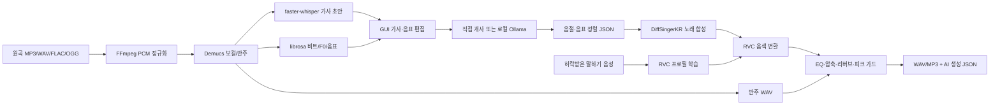

# 시스템 아키텍처

`app/core/project.py`는 `project.json`과 단계 상태를 저장합니다. 프로젝트 폴더의 `source.wav`, `vocals.wav`, `instrumental.wav`, `transcription.json`, `analysis.json`, `score.json`, `singing.wav`, `converted.wav`, `final.wav`, `final.mp3`, `final.json`이 각 단계의 독립된 출력입니다. 실패한 단계만 다시 실행할 수 있고 이전 결과는 남습니다. `app/core/pipeline.py`가 순서를 제어하며 GPU 작업은 별도 Python 프로세스로 실행해 종료 시 메모리를 회수합니다.

GUI는 `app/gui/main.py`의 PySide6 화면과 `QThread` 작업자로 구성됩니다. 가사·음표·음절 타이밍을 직접 수정할 수 있습니다. 전체 실행 버튼은 입력이 준비된 경우 단계를 순서대로 처리합니다. 가사만 수정하면 정렬 이후 상태를, 음표를 수정하면 정렬 이후 상태를 무효화합니다. 구간 재생성은 선택된 음절의 합성 WAV 부분만 다시 기록합니다.

원곡 분석은 자동 초안입니다. Whisper의 한국어 노래 인식과 YIN 음표 분할은 오류가 있으므로 GUI 편집이 핵심 검토 단계입니다. 현재 구조 구간은 보컬/무보컬에 대한 휴리스틱 레이블이며 벌스/후렴 확정 기능은 아닙니다. `score.json`은 DiffSingerKR의 한글 음절·길이·MIDI 음정을 직접 조건으로 넘깁니다. 한국어가 아닌 음절은 합성 전에 명확히 오류를 냅니다.

RVC 학습 데이터와 체크포인트는 `voice_data/`, `external/RVC/assets/`에 있고 Git에서 제외됩니다. 목소리 탭의 권한 확인이 없으면 학습·변환을 실행하지 않습니다. 변환 단계는 개별 GPU의 가용 메모리를 보고 0번 또는 1번을 택하며 두 6GB GPU를 하나의 12GB로 합산하지 않습니다. Demucs는 0번 GPU의 OOM 때 CPU로 재시도합니다. Whisper는 CPU int8로 실행합니다. 자동 개사만 선택적으로 `127.0.0.1:11434` Ollama 로컬 API에 연결합니다.

데모 실행의 수치, 실패 가능성, 새 PC 설치 검증 범위는 [APP_VALIDATION.md](APP_VALIDATION.md)에 있습니다.
